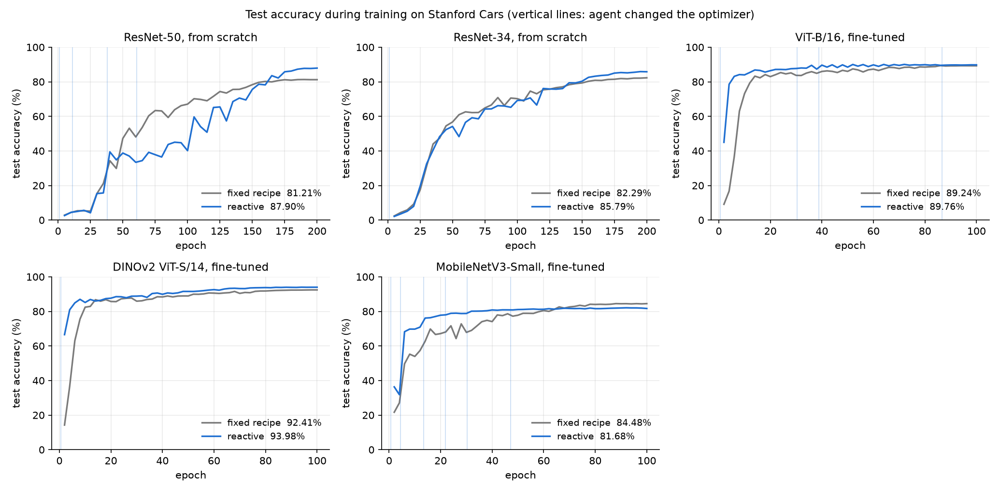

# Reactive Optimizers on Stanford Cars

**Can an LLM coding agent that watches a training run and rewrites the optimizer while it trains beat a fixed
training recipe?** This repository is an independent re-implementation of
*Reactive Optimizers* ([Bai et al., 2026](https://arxiv.org/abs/2610.33826)), tested on five image classifiers
on one consumer GPU. Each model is trained twice from the same starting point on identical batches: once with a
fixed recipe and once with the agent in control of the optimizer.



## Results

Top-1 accuracy on the 8,041 Stanford Cars test images (196 classes), which the agent never sees.
One run per setup unless noted.

| Model | Training | Fixed recipe | Reactive | Change | Agent cost* |
|---|---|---|---|---|---|
| ResNet-50 (25.6M) | from scratch, 200 epochs | 81.29% ± 0.12 (3 seeds) | **87.90%** | **+6.6** | $80 |
| ResNet-34 (21.8M) | from scratch, 200 epochs | 82.29% | **85.79%** | **+3.5** | $67 |
| ViT-B/16 (86M) | fine-tuned from ImageNet-1k, 100 epochs | 89.24% | 89.76% | +0.5 | $82 |
| DINOv2 ViT-S/14 (21.7M) | fine-tuned from DINOv2, 100 epochs | 92.41% | **93.98%** | **+1.6** | $62 |
| MobileNetV3-Small (1.7M) | fine-tuned from ImageNet-1k, 100 epochs | **84.48%** | 81.68% | −2.8 | $85 |

\*Estimated at API list prices. Training also pauses while the agent decides, adding 10–20 minutes per run.
Per-run data, including every program the agent wrote and its reasoning at each decision, is in
[`results/`](results/).

## Findings

1. **Large gains when the starting recipe is poorly tuned.** Both ResNets were trained from scratch with a
   generic, untuned SGD recipe. The agent raised the learning rate and the weight decay early on, trailed the
   baseline for most of the run, and finished 3.5–6.6 points ahead as the learning rate decayed. The ResNet-50
   gain is about 50 times the spread across baseline seeds.
2. **Mixed results on a standard fine-tuning recipe: +1.6, +0.5 and −2.8.** For every pretrained model the
   agent's first change was the same idea: a faster-learning new classifier head and smaller learning rates for
   lower layers. It gave a large early lead each time (+10.8 points at epoch 10 for ViT-B/16), and the baseline
   then closed most of the gap as its own learning rate decayed. DINOv2 kept 1.6 points of it, ViT-B/16 kept
   0.5, and MobileNetV3 lost 2.8.
3. **Winning runs changed the optimizer early and then left it alone.** ResNet-34 and DINOv2 each changed the
   optimizer exactly once, at the first decision, and kept it for the remaining 39 decisions. The one loss,
   MobileNetV3, is the run where the agent kept reacting: it cut every learning rate three times in response to
   short validation plateaus and stalled at 81–82% while the baseline kept improving.
4. **Mid-run leads are not time savings.** The reactive runs were ahead for much of training on the pretrained
   models, but a fixed recipe compared mid-schedule still has a high learning rate. A fair speed comparison needs
   a baseline trained on a shorter schedule, which this study did not run.

**Open question.** The ResNet-34 and DINOv2 gains each came from a single recipe change made at the first
decision. A fixed recipe with those settings from the start, without any agent, may match them. That control
would separate "an LLM proposes a better recipe" from "an LLM adapts the optimizer during training", and it is
the most important experiment not run here.

## How it works

```
 training loop (PyTorch)                         agent workspace
 ┌──────────────────────────────┐   pause   ┌───────────────────────────────────┐
 │ forward, backward            │ ────────▶ │ message: losses, validation,      │
 │ updater.step(grads)  ◀───────┼───┐       │ its analysis reports, errors      │
 │ every 50 updates:            │   │       │                                   │
 │   analysis.analyze(...)      │   │       │ agent edits updater.py and/or     │
 │ at decision points ──────────┼───┘       │ analysis.py (file tools only)     │
 └──────────────────────────────┘  install  └───────────────────────────────────┘
        trial window + rollback if a new updater fails or the loss goes non-finite
```

- **Two programs.** `updater.py` runs at every update and owns the whole optimizer: parameter groups, update
  rule, learning rates and schedule, weight decay, clipping, averaging. `analysis.py` computes whatever
  statistics the agent wants to see. Both start as the baseline's own optimizer and a basic report.
- **Decisions.** 40 scheduled decision points, 8 of them in the first 5% of training, plus up to 20 the
  agent's analysis can request. At each one, training pauses and the agent sees the training loss, its own
  reports, validation accuracy and any errors. It keeps one conversation for the whole run.
- **Fixed for both arms:** model, initialisation, data order, augmentation, loss, batch size and the number of
  updates. With the same seed, the baseline and reactive runs see identical batches.
- **Safety.** A program that fails to build is rejected. If a new updater raises or the loss turns non-finite,
  the weights are restored and the previous updater takes over; the agent sees the traceback next time.

Details are in [`docs/method.md`](docs/method.md).

## Experiments

| # | Write-up | Question |
|---|---|---|
| 1 | [ResNet-50 from scratch](docs/experiments/01_resnet50.md) | Does the agent beat an untuned recipe? Three seeds, cost cap and instructions compared. |
| 2 | [ViT-B/16 fine-tuned](docs/experiments/02_vit_b16.md) | Does it help on a standard fine-tuning recipe? |
| 3 | [Three small models](docs/experiments/03_small_models.md) | Does the pattern hold for ResNet-34, MobileNetV3-Small and DINOv2 ViT-S/14? |

## Repository layout

```
reactive_optimizer/      training script, data loading, and the reactive optimizer
  reactive/wrapper.py    pauses training, runs decisions, installs and rolls back programs
  reactive/backends.py   the agent backend, plus no-agent and scripted backends for testing
  reactive/templates/    the agent's instructions and the starting programs per model family
scripts/                 data preparation, experiment queues, export, comparison and plots
results/                 per-run metrics, final scores and the agent's programs and reasoning
docs/                    method, paper notes, experiment write-ups and figures
tests/scripted/          canned agent edits that exercise build failures, rollbacks and wake-ups
```

## Reproducing

Requirements: one CUDA GPU with 16 GB (all runs used an RTX 5060 Ti), Python 3.12, and the agent CLI described
in [`docs/method.md`](docs/method.md) for reactive runs.

```bash
python -m venv .venv && .venv/bin/pip install -r requirements.txt
.venv/bin/python scripts/prepare_data.py --download   # Stanford Cars, train/validation split
```

```bash
# Fixed recipe and reactive run, ResNet-50 from scratch (about 40 minutes each)
.venv/bin/python -m reactive_optimizer.train --mode baseline --name base_s0 --seed 0
.venv/bin/python -m reactive_optimizer.train --mode reactive --name react_s0 --seed 0
.venv/bin/python scripts/compare.py
```

```bash
# Test the decision machinery without an agent (no cost, about 1 minute): a valid swap, a syntax error,
# an updater that raises, one that makes the loss non-finite, and an analysis change
.venv/bin/python -m reactive_optimizer.train --mode reactive --backend scripted:tests/scripted \
    --name scripted_test --epochs 2 --decisions 6
```

The commands for every run in the write-ups are in [`scripts/experiments/`](scripts/experiments/). The agent's
choices differ between runs, so a rerun will not reproduce the exact numbers.

## Limitations

- **One run per setup** for most models. Only the ResNet-50 baseline has three seeds. Differences of a point or
  two on the fine-tuned models (ViT-B/16 +0.5, DINOv2 +1.6) may be within seed-to-seed variation; the DINOv2
  model is also not bit-reproducible run to run.
- **No fixed-recipe control** with the agent's chosen settings from the start (see the open question above).
- **Evaluation-timed weight swaps.** On ViT-B/16 the agent swapped averaged weights in around some evaluations.
  The final score is valid, but some mid-run points measure the averaged weights; see
  [experiment 2](docs/experiments/02_vit_b16.md).
- **Own implementation**, not the authors' package: a single process on one GPU with blocking decisions and no
  checkpoint or resume. Differences from the paper are listed in [`docs/method.md`](docs/method.md).

## References

- Bai, Liang, Teoh, Sitzmann. *Reactive Optimizers.* arXiv:2610.33826, 2026.
  [Paper](https://arxiv.org/abs/2610.33826) · [Blog](https://xingjianbai.com/reactive-optimizers/) ·
  [Official code](https://github.com/xingjian-bai/opal)
- J. Krause, M. Stark, J. Deng, L. Fei-Fei. *3D Object Representations for Fine-Grained Categorization.*
  ICCV Workshops, 2013 (Stanford Cars).

Notes on the paper: [`docs/paper_notes.md`](docs/paper_notes.md).

## License

MIT. See [LICENSE](LICENSE).
