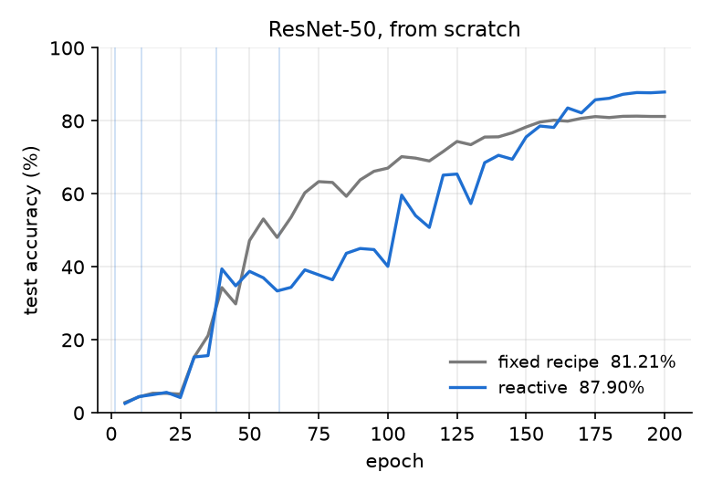

# Experiment 1: ResNet-50 from scratch

**Question.** When no tuned recipe exists, does a reactive optimizer beat a fixed one? A ResNet-50 trained from
scratch on Stanford Cars (7,356 training images, 196 classes) is a hard, data-poor setting where a generic
recipe is unlikely to be close to the best.

## Results

Top-1 accuracy on the 8,041 test images after the last update.

| Run | Seed | Setup | Test accuracy | vs same-seed baseline | Decisions | Agent cost |
|---|---|---|---|---|---|---|
| `base_s0` | 0 | fixed recipe | 81.43% | | | |
| `base_s1` | 1 | fixed recipe | 81.23% | | | |
| `base_s2` | 2 | fixed recipe | 81.21% | | | |
| **Baseline** | | mean ± std | **81.29% ± 0.12** | | | |
| `react_s0` | 0 | $15 cap, original instructions | 84.26% | +2.83 | 16 (cap reached at epoch ~55) | $15.51 |
| `react_s1` | 1 | $15 cap, original instructions | 81.51% | +0.28 | 16 (cap reached at epoch ~55) | $16.10 |
| `react_s2` | 2 | no cap, "aim for the best" instructions | **87.90%** | **+6.69** | 41 | $80.17 |

- The three baseline seeds agree to within 0.22 points, so the reactive gains are not seed noise.
- Every reactive run matched or beat its baseline. The size of the gain follows what the agent changed (below).
- The best setup, used for all later experiments, is no cost cap with instructions to aim for the highest final
  score. With a $15 cap the agent stopped being consulted around epoch 55 and the run finished on whatever
  program was installed then.

## What the agent changed

Only the learning rate and weight decay ever changed; the update rule stayed SGD with Nesterov momentum and a
cosine schedule.

| Run | Decision (epoch) | Change |
|---|---|---|
| `react_s0` | 1 (1) | Optimizer rewritten as its own SGD with the same settings, split into stem, conv, classifier and BatchNorm groups |
| `react_s0` | 10 (~21) | **Weight decay 5e-4 → 1e-3**, because validation had stalled while training loss kept falling |
| `react_s1` | 1 (1) | Same rewrite, same settings. **No recipe change for the rest of the run** |
| `react_s2` | 1 (1) | **Weight decay 5e-4 → 1e-3** |
| `react_s2` | 9 (~11) | **Peak learning rate 0.05 → 0.1**, ramped in over 300 updates; weight decay eased to 7.5e-4 |
| `react_s2` | 14 (~38) | **Weight decay 7.5e-4 → 1.5e-3** |
| `react_s2` | 18 (~61) | **Weight decay 1.5e-3 → 2.5e-3**, kept to the end |

Other edits only changed what the agent measured or added its own triggers for extra decisions. Every program
version and the agent's reasoning at each decision are in [`results/01_resnet50/`](../../results/01_resnet50/).

With the higher learning rate and stronger regularisation, `react_s2` trailed its baseline by more than 20
points mid-run (37.8% against about 60% at epoch 75). It overtook the baseline as the learning rate decayed, as
the agent's own predictions said it would.

## Interpretation

- **The gain tracks regularisation.** `react_s1` changed nothing and matched its baseline. The runs that raised
  weight decay won, and the run that raised both learning rate and weight decay, and kept adjusting them, won by
  the most.
- **What is not shown.** A fixed recipe with `react_s2`'s final settings (peak learning rate 0.1, weight decay
  about 2.5e-3) from the start was not run. The result shows that the agent found a much better recipe within a
  single run. It does not show that changing the recipe *during* training was necessary.
- **Cost.** Decisions added 8–15 minutes of waiting to a 40-minute run.

## Setup

- **Model.** `torchvision.models.resnet50(weights=None, zero_init_residual=True)`, 196-class head.
- **Fixed recipe (untuned).** SGD with Nesterov momentum 0.9, peak learning rate 0.05, weight decay 5e-4 on conv
  and linear weights (none on BatchNorm and biases), 5 warmup epochs then cosine decay to 0, label smoothing
  0.1, batch 64, bf16 autocast, 200 epochs (22,800 updates). About 40 minutes per run.
- **Reactive runs.** As described in [the method](../method.md). Validation every 5 epochs.
- **Commands.** [`scripts/experiments/01_resnet50.sh`](../../scripts/experiments/01_resnet50.sh).

## Notes on the runs

- `base_s1` was interrupted by a desktop-session crash at epoch ~50 and rerun from scratch. Since then all runs
  have been launched as background services independent of the desktop session.
- `react_s2` was first started with the original instructions. It was stopped at epoch 20 and restarted from
  scratch once the "aim for the highest final score" section was added; only the restarted run is reported.
