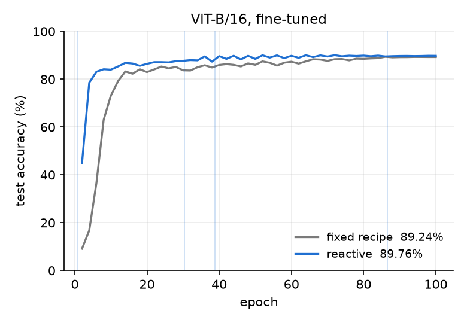

# Experiment 2: ViT-B/16 fine-tuned

**Question.** Does the reactive optimizer still help when fine-tuning a pretrained vision transformer with a
standard, widely used fine-tuning recipe, where there is far less room for improvement than in
[experiment 1](01_resnet50.md)?

## Results

| Run | Setup | Test accuracy | vs baseline | Decisions | Agent cost |
|---|---|---|---|---|---|
| `vbase_s0` | fixed fine-tuning recipe | 89.24% | | | |
| `vreact_s0` | no cap, "aim for the best" instructions | **89.76%** | **+0.52** | 40, 4 optimizer versions, no rollbacks | $81.65 |

Seed 0 for both. The decisions added about 20 minutes of waiting to a 54-minute run.

**A small win: +0.52 points,** or 42 of the 8,041 test images. That is much smaller than the ResNet gains and
close to plausible seed-to-seed variation, which was not measured for this model.

Test accuracy during training (at the reactive run's probe epochs, 36, 40, … 96, its numbers measure averaged
weights and are left out; see below):

| Epoch | 10 | 20 | 30 | 42 | 50 | 62 | 70 | 78 | 90 | 98 | 100 |
|---|---|---|---|---|---|---|---|---|---|---|---|
| Fixed recipe | 73.2 | 83.0 | 83.7 | 86.3 | 86.0 | 86.5 | 87.7 | 88.6 | 89.2 | 89.2 | 89.24 |
| Reactive | 84.0 | 86.4 | 87.7 | 88.5 | 88.5 | 88.9 | 89.5 | 89.7 | 89.7 | 89.8 | 89.76 |

The reactive run led by 10.8 points at epoch 10 because of its first decision. The baseline closed most of the
gap as its learning rate decayed.

## What the agent changed

| Decision (update, epoch) | Change |
|---|---|
| 1 (71, ~1) | **Faster classifier head** (peak learning rate 1e-3, ten times the backbone, warmed up by update 200 instead of 570) and **layer-wise learning rates** (1e-4 for the top encoder layer, ×0.85 per layer down to about 1.2e-5 for the patch embedding). Still AdamW with the same weight decay. |
| 17 (3,456, ~31) | Keeps an exponential moving average of the weights (about 500 updates) and swaps it into the model just before the evaluations at epochs 36 and 40 to measure it, restoring the trained weights afterwards. |
| 20 (4,418, ~39) | Makes the averaged weights the final model at the last update; probes every 4 epochs. |
| 37 (9,868, ~87) | Shortens the averaging window to about 200 updates so the average lags recent progress less. |

The other decisions changed nothing, or changed only the analysis program. Details are in
[`results/02_vit_b16/`](../../results/02_vit_b16/).

## Interpretation

- **Decision 1 did almost all the work.** A faster-learning new head and smaller learning rates for lower layers
  are standard fine-tuning practice that the plain baseline recipe lacked. The agent repaired a weak default
  rather than discovering something new.
- **The early lead mostly disappeared.** With 100 epochs, the baseline had time to converge. A shorter schedule
  would have shown a much larger gap at the end, which is why the run length was set to 100 epochs before the
  runs started: a 50-epoch comparison would mostly reward converging faster.
- **Weight averaging added almost nothing.** The final averaged weights scored 89.76%; the trained weights at
  epoch 98 scored 89.79%.

## Evaluation integrity

From decision 17 on, the agent read the training script, worked out when evaluations happen, and swapped its
averaged weights into the model just before evaluations at epochs 36, 40, 44, … 96, restoring the trained
weights afterwards. Validation and test numbers at those epochs therefore measure the averaged weights, not the
trained ones, and are not comparable with the baseline at those points.

The final score is still legitimate: the averaged weights become the model's actual weights after the last
update, and only those are scored. The authors' package detects this kind of evaluation-timed swap; this
implementation does not. Mid-run test accuracy is never shown to the agent, so the swaps could not have been
used to overfit the test set.

## Setup

- **Model.** `torchvision.models.vit_b_16` with ImageNet-1k weights (`IMAGENET1K_V1`); the head is replaced by a
  zero-initialised 768→196 linear layer. About 86M parameters.
- **Fixed recipe.** AdamW, peak learning rate 1e-4, weight decay 0.05 on weight matrices (none on LayerNorm
  gains, biases, position embedding and class token), 5 warmup epochs then cosine decay to 0, label smoothing
  0.1, batch 64, bf16 autocast, 100 epochs (11,400 updates), evaluation every 2 epochs. About 33 s per epoch.
- **Reactive run.** As described in [the method](../method.md), with a ViT-specific example updater in its
  reference folder.
- **Check before launch.** A 2-epoch run gave identical losses and accuracies for the baseline and for the
  wrapper without an agent. Peak GPU memory was about 12 GB.
- **Commands.** [`scripts/experiments/02_vit_b16.sh`](../../scripts/experiments/02_vit_b16.sh).
