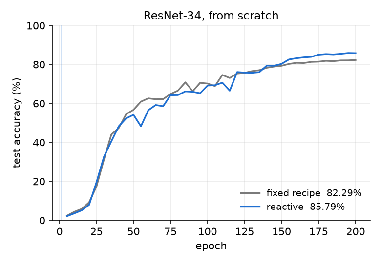
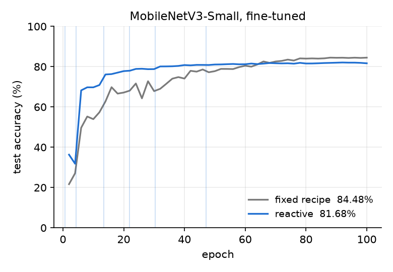
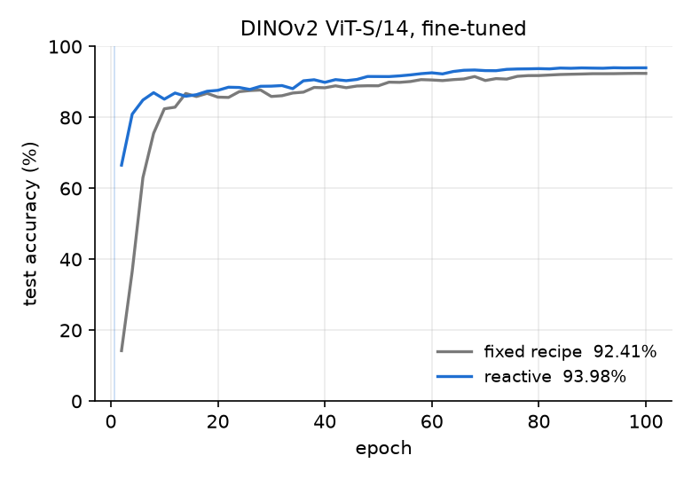

# Experiment 3: three small models

**Question.** Does the pattern from experiments 1 and 2 (large gains from scratch, small gains when
fine-tuning) hold across different architectures? Three small models: a CNN trained from scratch, a tiny
pretrained CNN, and a small self-supervised vision transformer.

## Results

| Model | Training | Fixed recipe | Reactive | Change | Optimizer versions | Agent cost |
|---|---|---|---|---|---|---|
| ResNet-34 (21.8M) | from scratch, 200 epochs | 82.29% | **85.79%** | **+3.50** | 1 | $66.91 |
| MobileNetV3-Small (1.7M) | fine-tuned, 100 epochs | **84.48%** | 81.68% | −2.80 | 6 | $84.92 |
| DINOv2 ViT-S/14 (21.7M) | fine-tuned, 100 epochs | 92.41% | **93.98%** | **+1.57** | 1 | $62.16 |

Seed 0, one run per setup. Same agent and instructions as the best setup of experiment 1 (no cost cap, "aim for
the highest final score").

 

## ResNet-34: one early change, +3.5 points

At its first decision, before the end of epoch 1, the agent rewrote the optimizer: peak learning rate
0.05 → 0.08, weight decay 5e-4 → 8e-4 (still none on BatchNorm and biases), and gradient-norm clipping at 5,
keeping SGD with Nesterov momentum and the cosine schedule. It kept that program for the remaining 39 decisions.

The run trailed the baseline from about epoch 35 to 130 (59.2% against 62.2% at epoch 65), then pulled ahead as
the learning rate decayed (83.2% against 80.9% at epoch 160) and finished 3.5 points higher. This is the same
direction that won experiment 1: more learning rate and more regularisation for a from-scratch CNN.

Because the whole gain came from one change made before training was under way, this run does not show that
reacting during training helped. The same settings as a fixed recipe from the start may well reach the same
accuracy; that control was not run.

## MobileNetV3-Small: a strong start, then too many cuts, −2.8 points

| Decision (epoch) | Change |
|---|---|
| 1 (~0.6) | AdamW split by role: classifier head at peak learning rate 5e-3 with a 1-epoch warmup, backbone at 1e-3 (the baseline's rate), no weight decay on BatchNorm and biases |
| 7 (~4.4) | Head 2.5e-3, backbone 4e-4, earliest blocks (stem and blocks 0–2) 2e-4 |
| 11 (~13) | All learning rates ×0.6 (validation plateau, validation loss rising) |
| 14 (~22) | All learning rates ×0.6 again |
| 17 (~30) | All learning rates ×0.7, about a quarter of the decision-7 rates |
| 23 (~47) | Uniform weight averaging from update 8,000, copied into the model at update 11,100 |

The role-based learning rates gave a fast start: 77.1% at epoch 18, against 67.2% for the baseline at epoch 20.
The agent then treated short validation plateaus as a reason to cut every learning rate, three times in 17
epochs. From epoch 32 to the end the run stayed at 81–82%, while the baseline, with its learning rate still
high, kept improving to 84.5%. Weight averaging did not recover the gap.

This is the clearest failure in the study, and it matches the abandoned "more capable agent" (see
[the index](README.md)): reacting to short-term evidence favours what helps now, not what wins at the end.

The agent cost more here than anywhere else ($84.92) for a model that trains in under 3 minutes: training
waited about 11 minutes for decisions, and with one conversation per run, late decisions cost about $3.30 each.

## DINOv2 ViT-S/14

At its first decision, at update 71, the agent replaced the starting AdamW with its own:

- **layer-wise learning rates:** 2e-4 for the last block and final norm (twice the baseline's peak), ×0.85 per
  block going down, about 2.4e-5 for the patch and position embeddings;
- **a faster classifier head:** 2e-3, because the new head starts at zero and was holding the network back;
- **a shorter warmup** (300 updates instead of 570), gradient-norm clipping at 5, and the same weight decay.

It carried over the baseline optimizer's moment estimates and kept this program, unchanged, for the remaining 40
decisions; later edits only changed its monitoring.

| Epoch | 2 | 6 | 10 | 20 | 40 | 60 | 80 | 100 |
|---|---|---|---|---|---|---|---|---|
| Fixed recipe | 14.2 | 63.0 | 82.4 | 85.7 | 88.4 | 90.6 | 91.8 | 92.41 |
| Reactive | 66.5 | 84.9 | 85.2 | 87.6 | 89.9 | 92.6 | 93.8 | **93.98** |

The reactive run led throughout. Unlike ViT-B/16 in [experiment 2](02_vit_b16.md), the baseline never closed the
gap: the reactive run's higher learning rates for the upper blocks kept it about 1.5 points ahead from epoch 40
to the end. Its final 93.98% is the best result in the study. Decisions added about 7.5 minutes to a 28-minute
run.

This is one run of a model that is not bit-reproducible, so the 1.57-point gain is suggestive rather than
established. Like ResNet-34, it came from a single change at the first decision, so it does not show that
adapting the optimizer *during* training was needed.

## Interpretation

- **From scratch, the agent helps.** Both ResNets in this study (experiments 1 and 3) gained 3.5–6.6 points by
  moving to a higher learning rate and stronger regularisation early.
- **Fine-tuning, the results are mixed:** +1.6 (DINOv2), +0.5 (ViT-B/16, experiment 2) and −2.8 (MobileNetV3),
  each a single run, at the same agent cost as the from-scratch runs.
- **Early changes help; repeated reactions hurt.** The two runs in this experiment that gained changed the
  optimizer once, at the first decision, and left it alone. The one that lost kept cutting the learning rate in
  response to short-term validation noise.

## Setup

- **Models.**
  - ResNet-34: `torchvision.models.resnet34(weights=None, zero_init_residual=True)`.
  - MobileNetV3-Small: timm `mobilenetv3_small_100.lamb_in1k` (ImageNet-1k weights), new 196-class classifier.
  - DINOv2 ViT-S/14: timm `vit_small_patch14_dinov2.lvd142m` (DINOv2 self-supervised weights) at 224×224, with
    the position embedding resized from 518×518 and a new zero-initialised 196-class head.
- **Fixed recipes (untuned).**
  - ResNet-34: the ResNet-50 recipe from experiment 1 (SGD, Nesterov momentum 0.9, peak learning rate 0.05,
    weight decay 5e-4, 5 warmup epochs then cosine decay, 200 epochs, evaluation every 5 epochs).
  - MobileNetV3-Small: AdamW, peak learning rate 1e-3, weight decay 0.05, 5 warmup epochs then cosine decay, 100
    epochs, evaluation every 2 epochs.
  - DINOv2 ViT-S/14: the ViT-B/16 recipe from experiment 2 (AdamW, peak learning rate 1e-4, weight decay 0.05).
  - All use label smoothing 0.1, batch 64 and bf16 autocast, with no weight decay on normalisation gains,
    biases, position embeddings or class tokens.
- **Reactive runs.** As described in [the method](../method.md). The timm models get a generic example updater
  that matches their parameter names.
- **Checks before launch.** All three models trained for 2 epochs without errors. Peak GPU memory: 6.6 GB,
  4.6 GB and 8.5 GB. The DINOv2 model is not bit-reproducible run to run, because of timm's attention kernels,
  so its baseline and reactive runs see identical batches but not bit-identical arithmetic.
- **Commands.** [`scripts/experiments/03_small_models.sh`](../../scripts/experiments/03_small_models.sh).
